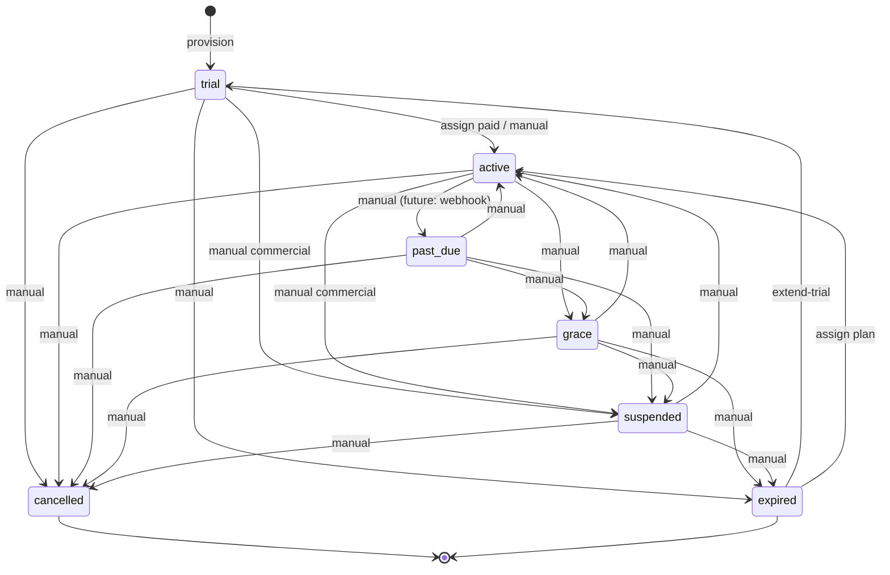

# P2.0 — Commercial Plan Catalog & Subscription Foundation

**Baseline HEAD:** `2a0974e41af9e334e147794f45e258f34d6814d3`  
**Migration:** `0023_subscription_foundation`  
**Status:** Foundation only — no payment provider, no entitlement enforcement.

## Existing architecture (audit summary)

| Capability | Existing source | Actual behavior | Decision |
|------------|-----------------|-----------------|----------|
| Plan catalog | `subscription_plans` (0016) | Single `trial-14d` row; UNIQUE(code); mutable only via migration by convention | **Reuse** — extend columns; immutable revisions via new rows |
| Tenant subscription | `subscriptions` UNIQUE(tenant_id) | One row; status=`trial` at provision; dates set; **unenforced** | **Reuse** — keep 1:1 current row; add history table |
| Trial | `create_trial_subscription` | 14-day window from plan.trial_days; no expiry job | **Reuse** — keep status name `trial` (not `trialing`) |
| Limits | `max_*` on plan + `PlanLimits.enforced=False` | Informational in tenant/platform reads | **Preserve** — still unenforced (P2.2) |
| Feature flags | Specialty packs only | Not commercial SKUs | **Add** plan `features` JSONB (informational) |
| Payment provider | None | — | **Do not add** |
| Tenant status | `tenants.status` + `get_ctx` hard-fail if ≠ active | Abuse/ops axis; also blocks portal via same gate | **Do not reuse for billing**; document transition (P2.3) |
| Ownership | `tenant_owners` + membership | Subscription FK → tenant only | **Keep** — never infer from user alone |

**What existing subscriptions are:** a **trial plan assignment** plus a reserved status vocabulary for a future lifecycle. They are **not** payment-provider-backed and **not** an enforced entitlement system.

## Plan versioning strategy

O1’s `UNIQUE(code)` blocked same-code revisions. P2.0 resolves that without forking a second catalog table (aligned with [subscription architecture audit](7fd44a59-ab04-48db-82e9-a934fa2ead98)):

- Stable product identity: `family_code` (e.g. `starter`, `trial-14d`).
- Immutable revision: new row with `version = N+1`, unique `(family_code, version)`.
- Globally unique `code` kept (e.g. `starter-v1`, `starter-v2`) — revision identity in the code suffix, not by dropping `UNIQUE(code)`.
- Catalog listing (`list_active_plans`) shows the latest **active** revision per family.
- Lookups by exact `code` remain deterministic; subscriptions keep `plan_id` on the historical revision.
- `create_plan_revision()` deactivates prior active rows in the family by default.

## Subscription lifecycle

- **Manual now:** assign-plan, transition, extend-trial (platform admin).
- **Future webhooks (P2.4):** past_due / renew / cancel confirmation — never invented here.
- Status names keep existing DB check constraint vocabulary (`trial`, `grace`, not `trialing` / `grace_period`).

## Tenant ownership & authorization

- Subscription `tenant_id` is the SaaS customer.
- Read: `subscription.read` (tenant_admin seed) + `X-Tenant` match.
- Mutate: platform admin only (`get_platform_admin`); `subscription.manage` is PLATFORM_ONLY.
- Patients lack `subscription.read` — cannot administer.
- Multi-membership: selector chooses tenant; subscription is always that tenant’s row.

## Billing state vs security suspension

| Axis | Field | Today | P2.0 | Future |
|------|-------|-------|------|--------|
| Abuse / security | `tenants.status` | Hard-fail in `get_ctx` if ≠ active; blocks staff + portal | **Unchanged** — not weakened | Keep for abuse |
| Commercial | `subscriptions.status` | Informational | Transitions + history; **does not** set `tenants.status` | P2.3: portal/staff gates use commercial status for write limits only |
| Portal records | portal_links + clinical reads | Blocked when tenant inactive | **Not changed** in P2.0 (unsafe partial fix avoided) | Decouple commercial lapse from portal reads |

**Transition plan (P2.3):** introduce commercial write-gates on invite/location create from `subscriptions.status`; keep `tenants.status` for abuse; allow portal reads when subscription is past_due/grace/suspended but tenant is active.

## Migration / backfill

- Additive columns on `subscription_plans` / `subscriptions`.
- Backfill `family_code=code`, version=1, trial description/features.
- Seed `starter-v1` / `growth-v1` catalog prices (INR paise) — **display only**.
- `subscription_events` + RLS + platform SELECT; backfill `created` events.
- Seed role merge: `subscription.read` → tenant_admin; `subscription.manage` → platform_admin.
- Downgrade drops new columns/table; leaves seed plan rows (safe).

## APIs

| Method | Path | Auth |
|--------|------|------|
| GET | `/api/v1/plans` | Authenticated session |
| GET | `/api/v1/plans/{code}` | Authenticated session |
| GET | `/api/v1/tenants/{id}/subscription` | `subscription.read` + tenant match |
| GET | `/api/v1/tenants/{id}/subscription/events` | `subscription.read` + tenant match |
| POST | `.../assign-plan` | Platform admin |
| POST | `.../transition` | Platform admin |
| POST | `.../extend-trial` | Platform admin |

UI: `/plans`, `/subscription` — informational; no checkout buttons.

## Known limitations

- Limits not enforced.
- No payment provider / webhooks / invoices.
- Portal still coupled to `tenants.status` (pre-existing).
- No last-owner protection.
- Platform assign is operational tooling, not self-serve billing.
- Catalog prices are not charges.

## Payment-provider boundary (future)

Store provider customer/subscription ids only in `subscriptions.provider_ref` (or a later `subscription_customers` table). Never put provider ids on patients. Never share clinic AR tables. Webhook idempotency ledger is out of scope until P2.4.
